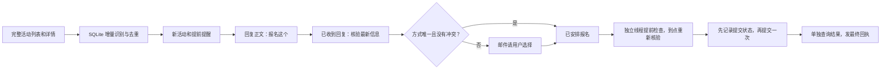

# 活动监测与邮件确认助手

**让程序盯活动，你用一封邮件决定是否报名。** Python 标准库实现的通用模板，包含 SQLite 去重、提前提醒、邮件回复确认、独立报名执行线程和结果核实。

默认离线运行：不需要账号、密码或服务器，不发邮件，不访问活动网站，不提交真实报名。项目由人与 AI 协作整理，适合从个人自动化项目开始学习。

## 先跑通一个演示

需要 Python 3.10+。macOS / Linux 可直接运行；Windows 建议 WSL（常驻服务使用 `fcntl` 锁）。下载代码并进入目录后：

```bash
python3 -m event_assistant init
python3 -m event_assistant demo
```

第二条命令会生成模拟活动、合成一封“报名这个”的用户回复，跑完授权和假报名，再输出邮件预览目录。用浏览器打开其中的 HTML，即可看到收件回执、安排回执和最终结果。这里的成功只代表**本机假数据流程成功**。

输出应包含：

```json
{"offline_demo": true, "synthetic_reply": true, "state": "success",
 "email_previews": 3, "real_emails_sent": 0,
 "real_network_requests": 0, "real_registrations_submitted": 0}
```

查看列表或持续生成预览：

```bash
python3 -m event_assistant check
python3 -m event_assistant run
```

`run` 用 Ctrl+C 停止。在另一个终端执行 `python3 -m event_assistant status` 查看心跳和最近读取结果。默认演示活动只初始化一次，不会每次扫描都推迟报名时间。需要重新演示，直接再运行 `demo`，它会另建隔离目录。

## 核心流程



默认每 5 分钟读列表，报名开始前 15 分钟提醒；开启真实邮箱后默认每 30 秒读回复。**轮询周期不是送达保证**，网络、邮件服务和客户端推送都会影响实际时间。

## 从模板到自己的应用

1. **先用本地数据监测。** 将 `config.json` 的 `adapter` 改为 `json`，`source_file` 指向你自己的完整 JSON 列表，格式见 [示例](examples/events.json)。原子替换完整文件，别把失败的一页当完整列表。运行 `check` 验证，再运行 `run` 看预览。
2. **接真实数据。** 按 [适配器说明](docs/ADAPTERS.md) 将目标平台的合法读取方式映射为统一字段。模板没有绑定任何机构、登录系统或真实报名接口。
3. **接邮箱。** 按 [部署说明](docs/DEPLOYMENT.md) 配置 SMTP / IMAP 和环境变量。先人工验证发信、收信和回复，再启用真实报名。
4. **接报名。** 实现并验证自有适配器的提交及结果查询，同时显式开启 `signup_enabled`、`allow_live_submissions`。只会执行已确认活动；不包含支付或购票功能。
5. **放到云端常驻。** 使用 systemd，检查服务、心跳、最近成功读取和模拟回复验收，保留私有状态库以防重启后重复处理。

## 邮件如何确认

打开**对应的单场活动提醒**，点“回复”，保留原主题，正文第一行写：

```text
报名这个
```

方式不唯一或有时间冲突时会再问；也可回复 `报名线上`、`报名线下`，同方式多个地点按邮件中的 `报名1` 等选择。`不报名` 撤回尚未提交的自动报名授权，不会取消平台已有报名。

三种状态分别发邮件：**已收到回复 → 已安排报名 → 报名成功或失败/待核实**。第一封只证明收到意愿；第二封说明已排任务；只有官方结果被核实后才能发成功。收到“请选择”时，需要继续作答。

主题前面的短标记由程序保存，用户不用复制。识别优先依靠邮件关联头，辅以已签发的主题标记；不能把没有关联信息的“报名这个”猜成最新一场。首次汇总邮件可能包含多场，不能直接当作单场授权。

## 保留的保护机制

| 情况 | 行为 |
|---|---|
| 重复回复 / 重启 | 摘要和任务状态去重，不重复提交 |
| 多个参加方式 / 时间冲突 | 询问用户，未明确选择不提交 |
| 活动时间、地点、账号或选项变化 | 原授权失效，重新确认 |
| 满额 | 普通任务暂停；持续候补须另有明确授权 |
| 已确认的二选一候补 | 核心 API 有互斥锁，提交一场前锁住整组；默认邮件流程不自动开启 |
| 官网截止 / 已设置的个人候补截止 | 停止新提交，已提交结果继续核实 |
| 提交超时或程序重启 | 保留提交记录，只查结果，不盲目再发一次 |
| 短暂读取失败 | 重试；持续异常才告警，连续稳定成功后才发恢复通知 |

报名线程不处理 IMAP、SMTP 或全量目录同步。开报前 30 秒可进行就绪检查，到点使用新的并行读取核验账号、详情和已报名日程；不会把提前缓存的名额当成到点事实。是否抢到名额仍由平台规则、网络和剩余名额决定。

## 测试、隐私与限制

```bash
python3 -m unittest discover -s tests -v
python3 scripts/check_public_tree.py
```

测试阻断 socket 连接，覆盖离线流程和异常分支。**没有验证你的真实网站、邮箱供应商兼容性或长期云端稳定性**。上线前请使用自己的测试账号和演示活动完成 [验收清单](docs/ACCEPTANCE.md)。

公开模板没有机构实现、真实活动标题、登录状态或运行数据库；地址统一使用 `example.com`。密码只从环境变量读取；`config.json`、`.env`、`state/`、`previews/` 默认不入库。不要把真实配置、日志或截图提交到 Issue。详见 [隐私说明](docs/SECURITY.md)。

想让 AI 帮你接入自己的场景，从 [可复用开发提示词](docs/PROMPTS.md) 开始。票务余量、价格变化等可作为监测思路的延伸，但本仓库没有实现相关平台接入、购票或收益验证。

MIT License，见 [LICENSE](LICENSE)。
